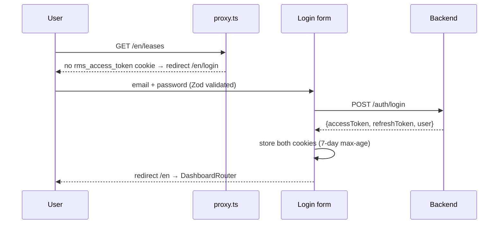
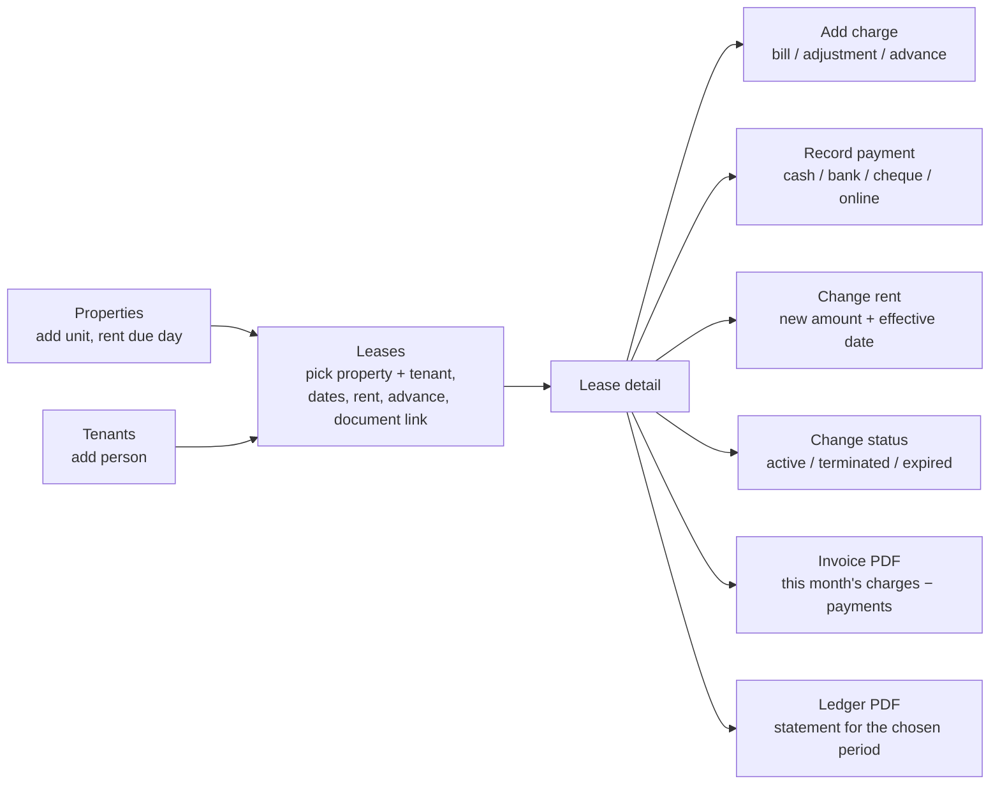

# RMS Frontend

**Rent Management System UI**: the admin web app for the multi-company rent platform. Super admins use it to onboard companies and users. Company admins use it to run properties, tenants, leases, ledgers and payments, to print invoices and statements, and to ask an AI assistant about their data by typing or by voice.

Next.js 16 (App Router + Turbopack). The API is in the sibling repo [`rms-backend`](../rms-backend/README.md), which also documents the full database schema and business rules.

---

## Contents

1. [Stack](#stack)
2. [Getting started](#getting-started)
3. [Screens by role](#screens-by-role)
4. [Project structure](#project-structure)
5. [User flows](#user-flows)
6. [Data fetching](#data-fetching)
7. [Auth and session](#auth-and-session)
8. [Language switching](#language-switching)
9. [Theming](#theming)
10. [Conventions](#conventions)

---

## Stack

| Concern | Choice |
| --- | --- |
| Framework | Next.js 16.3 / React 19.3 |
| Styling | Tailwind CSS 4 (CSS-first `@theme` tokens) |
| i18n | next-intl 4: English / Urdu with RTL |
| Theming | next-themes: light / dark / system |
| Data | TanStack Query 5 + Axios |
| Validation | Zod 4 |
| Charts | Recharts 3 |
| PDF | jsPDF + jspdf-autotable (built in the browser) |
| Icons | lucide-react |
| Voice | Browser Web Speech API (speech-to-text and text-to-speech), no extra package |

---

## Getting started

```bash
pnpm install
cp .env.example .env.local
pnpm dev
```

The frontend runs on **:5001** and expects the backend on **:5000**:

```
NEXT_PUBLIC_API_BASE_URL=http://localhost:5000/api/v1
```

That URL is the backend host plus its global prefix (`API_PREFIX=api`) and URI version (`API_VERSION=1`). The backend must list `http://localhost:5001` in `CORS_ORIGINS`.

| Script | What it does |
| --- | --- |
| `pnpm dev` | Dev server on :5001 |
| `pnpm build` / `pnpm start` | Production build / serve on :5001 |
| `pnpm lint` | ESLint |
| `pnpm typecheck` | `tsc --noEmit` |

To sign in the first time, use the super admin that the backend's `pnpm db:seed` creates (`SEED_SUPER_ADMIN_EMAIL` / `SEED_SUPER_ADMIN_PASSWORD`).

---

## Screens by role

Every route has a locale prefix (`/en/...`, `/ur/...`).

| Route | Screen | Role | In sidebar |
| --- | --- | --- | --- |
| `/login` | Email + password sign-in | Anonymous | — |
| `/` | Dashboard. The content depends on the role (see below) | Any | ✓ |
| `/companies` | Company list, create/edit, deactivate/restore | super_admin | ✓ |
| `/users` | User list, create/edit, deactivate/restore | super_admin | ✓ |
| `/properties` | Property list (with `P-0001` numbers), create/edit, deactivate/restore | client_admin | ✓ |
| `/tenants` | Tenant list, create/edit, deactivate/restore | client_admin | ✓ |
| `/leases` | Lease list, create/edit, change status, change rent | client_admin | ✓ |
| `/leases/[id]` | Lease detail: ledger statement, charges, payments, PDFs | client_admin | via lease list |
| `/ledger` | Company-wide ledger, filterable by lease | client_admin | URL only |
| `/payments` | Company-wide payments list | client_admin | URL only |
| Every signed-in page | AI assistant: floating button, bottom corner | client_admin | — |

The sidebar filters links by `roles` in [src/config/navigation.ts](src/config/navigation.ts). Every page is also wrapped in [`RequireRole`](src/components/layout/require-role.tsx), which reads `GET /auth/me`. The backend enforces the same rules, so the UI checks only keep the screens consistent with what the API allows.

---

## Project structure

```
rms-frontend/
├── messages/                    # en.json, ur.json translation catalogues
├── public/
├── next.config.ts
└── src/
    ├── proxy.ts                 # Next 16 "proxy" (middleware): locale prefix + auth redirect
    ├── app/
    │   ├── globals.css          # OKLCH theme tokens (:root / .dark) + base layer
    │   ├── icon.svg
    │   └── [locale]/
    │       ├── layout.tsx       # <html lang dir>, fonts (Noto Nastaliq for Urdu), providers
    │       ├── login/page.tsx   # No app chrome
    │       └── (dashboard)/     # Signed-in shell
    │           ├── layout.tsx   # Sidebar + main area
    │           ├── page.tsx     # DashboardRouter
    │           ├── companies/   users/                     # super_admin
    │           ├── properties/  tenants/  leases/  leases/[id]/  ledger/  payments/   # client_admin
    ├── components/
    │   ├── layout/              # app-sidebar, app-nav, user-menu, require-role, page-heading,
    │   │                        # language-switcher, theme-toggle, powered-by
    │   ├── providers/           # app, query, theme, toast providers
    │   └── ui/                  # alert, badge, button, card, confirm-dialog, date(-time)-picker,
    │                            # empty-state, form-field, form-grid, input, modal, pagination,
    │                            # radio-group, search-input, select, skeleton, stat-card, table, textarea
    ├── config/                  # site, auth (cookies/endpoints), roles, navigation, pagination, phone, property, assistant
    ├── features/                # One slice per backend module
    │   ├── auth/  companies/  users/  dashboard/
    │   ├── properties/  tenants/  leases/  ledger/  payments/
    │   ├── assistant/           # AI chat panel + voice (launcher, panel, composer, use-assistant-chat)
    │   └── <feature>/
    │       ├── api/             # <feature>.api.ts fetchers + <feature>-keys.ts query keys
    │       ├── components/      # <feature>-view, -table, -form-dialog (+ feature-specific dialogs)
    │       ├── hooks/           # use-<feature>s (list), use-save-<feature>, use-<feature>-status,
    │       │                    # use-<feature>-options (for selects)
    │       ├── schemas/         # Zod schemas mirroring the backend DTOs
    │       └── types/           # Component prop interfaces
    ├── hooks/                   # use-debounced-value, use-form-state, use-is-hydrated, use-toast,
    │                            # use-speech-recognition, use-speech-synthesis
    ├── i18n/                    # routing (locales), navigation (localised Link/router), request config
    ├── lib/
    │   ├── api-client.ts        # Axios instance: base URL, bearer token, envelope unwrap, 401 refresh
    │   ├── auth-session.ts      # Read/write/clear the token cookies
    │   └── query-client.ts      # TanStack QueryClient factory
    ├── types/                   # Shared I-prefixed interfaces / T-prefixed unions, one file per domain
    └── utils/                   # cn, format (currency/date), cookie, query-params, status, period,
                                 # lease label, ledger-display, pdf / invoice-pdf / ledger-pdf, zod helpers, speech
```

---

## User flows

### Sign in



### Super admin: onboard a company

1. **Companies → New.** Enter the name, contact details and city. Optionally add the company's SMTP email and mail password and turn on **invoice email**, so that generated rent invoices go to that company's tenants.
2. **Users → New.** Create a `client_admin` and assign it to the company. The backend emails the login details to the new user.
3. **Dashboard.** The counters come from the list endpoints (`meta.totalItems` with `limit=1`), and there are lists of recently added companies and users. The **Generate monthly rent** button calls `POST /ledger/generate-monthly-rent` for every company and reports what was generated and what was skipped.

The forms follow the backend rules: a `super_admin` can't be given a company, a company can't be deactivated while it still has active users, and leaving the password blank in the edit dialog keeps the current one. Entering a new one triggers a password-changed email.

### Client admin: day-to-day



- **Dashboard.** Stat cards (tenants, properties, active leases, this month's payments compared with last month), a payments trend chart (6 months, 1 year or all time), a property status breakdown, recent payments, and the leases with the most outstanding.
- **Lease detail** (`/leases/[id]`) is the main working screen. It shows the lease, its outstanding balance and the full ledger with running balances. It supports search and a period filter (all, current month, last month, last 3 months, last 6 months). From here the admin can add charges, record payments, deactivate or restore entries, change the rent or status, and open the PDFs.
- **Deactivate, don't delete.** Every destructive action asks for confirmation and only sets `status` to false. A deactivated ledger entry stays on the statement, struck through and faded, and no longer counts towards the balance. Restoring it adds it back.
- **PDFs** are built in the browser by [invoice-pdf.ts](src/utils/invoice-pdf.ts) and [ledger-pdf.ts](src/utils/ledger-pdf.ts), and open in a new tab. Each has the company name, an `INV-` / `LDG-` document number, the property number, the lease term and a "Powered by" footer.
- **AI assistant.** A floating button opens a chat panel that calls the backend's `POST /ai/chat` (Gemini). For example: "who still owes rent?", "summarise this month", "when did Ahmed Raza last pay?". It is read-only for now.
  - **Voice.** The mic button uses the browser's speech recognition in the current locale (`en-US` or `ur-PK`) and sends the question as soon as the user stops speaking. Answers to spoken questions are read aloud; the speaker button turns this off and the stop button cuts it short. Typed questions are never read aloud.
  - **Browser support.** Voice input needs Chrome or Edge, and the mic button is disabled elsewhere. Urdu read-aloud needs an Urdu voice installed in the OS. Without one, the browser falls back to its default voice.
  - **Conversation state.** The backend is stateless, so [use-assistant-chat.ts](src/features/assistant/hooks/use-assistant-chat.ts) keeps the conversation and replays the last 20 turns as `history`. Closing the panel keeps the conversation; reloading the page clears it.

### Lists

Every list screen works the same way, matching the backend's list contract (paginated, searchable, newest first):

- debounced search plus filters (status everywhere, plus role and company on users, and property, tenant or status on leases),
- server-side pagination through the shared `Pagination` component,
- a create/edit dialog validated by a Zod schema that mirrors the backend DTO, so common mistakes are caught before a request goes out. If the backend rejects a request, the dialog shows the API's message in an alert. Successful saves show a toast.

---

## Data fetching

Every call goes through the shared Axios instance in [src/lib/api-client.ts](src/lib/api-client.ts), which:

- prefixes `NEXT_PUBLIC_API_BASE_URL`,
- attaches `Authorization: Bearer <access token>` from the session cookie,
- unwraps the backend `{ success, message, data, error }` envelope so callers receive `data`,
- turns every failure into an `IApiError` (`status`, `code`, `message`, `details`),
- on a `401`, refreshes once through `/auth/refresh` and retries the request. Concurrent 401s share a single refresh call. If the refresh fails, the session is cleared and the user is sent to the login page.

Each feature slice owns its fetchers, query keys and hooks. Query keys are kept in one place per feature (`leaseKeys`, `ledgerKeys`, ...), and mutations invalidate the affected keys. For example, recording a payment refreshes the payments list, the ledger and the lease balance.

---

## Auth and session

- `POST /auth/login` returns a token pair and the user. The tokens are stored in the `rms_access_token` and `rms_refresh_token` cookies ([src/lib/auth-session.ts](src/lib/auth-session.ts)). Both cookies last as long as the backend refresh token (7 days), so an expired access token is refreshed silently.
- [src/proxy.ts](src/proxy.ts) guards routes before the page renders. An anonymous request is redirected to `/{locale}/login`, and a signed-in request to the login page is redirected to `/{locale}`.
- The cookies are written client-side, so JavaScript can read them. If the backend ever sets `httpOnly` cookies itself, remove `auth-session.ts` and have the proxy read the cookie names directly.
- Route names, cookie names and auth endpoints are in [src/config/auth.ts](src/config/auth.ts).

---

## Language switching

The locale is part of the URL (`/en/...`, `/ur/...`) and is resolved by [src/proxy.ts](src/proxy.ts). `<html lang dir>` is set per request, and Urdu loads Noto Nastaliq Urdu automatically.

Use logical CSS properties (`ms-*`, `me-*`, `ps-*`, `pe-*`, `text-start`, `text-end`) so layouts mirror correctly in RTL. Generated PDFs are always in English.

To add a locale, extend `locales` in [src/i18n/routing.ts](src/i18n/routing.ts) and add a matching file in [messages/](messages/). If it is RTL, mark it in [src/utils/direction.ts](src/utils/direction.ts).

---

## Theming

Colours are OKLCH custom properties in [src/app/globals.css](src/app/globals.css): `:root` for light and `.dark` for dark, exposed to Tailwind via `@theme inline`. Use the semantic classes (`bg-card`, `text-muted-foreground`, `border-border`) rather than raw palette values.

---

## Conventions

- **Types.** No `any`. Interfaces start with `I` and live under `src/types/` or the feature's `types/` folder, never inline next to the component.
- **Styling.** No inline styles. Use Tailwind classes, with `cn()` to merge them.
- **Helpers.** Reusable helpers belong in `src/utils/` or `src/hooks/`, written generically.
- **Style.** Comments are one line at most. Use `const` by default and camelCase.
- **Next.js 16** has breaking changes compared with older versions. Read [AGENTS.md](AGENTS.md) and the bundled docs in `node_modules/next/dist/docs/` before changing routing or proxy code.
