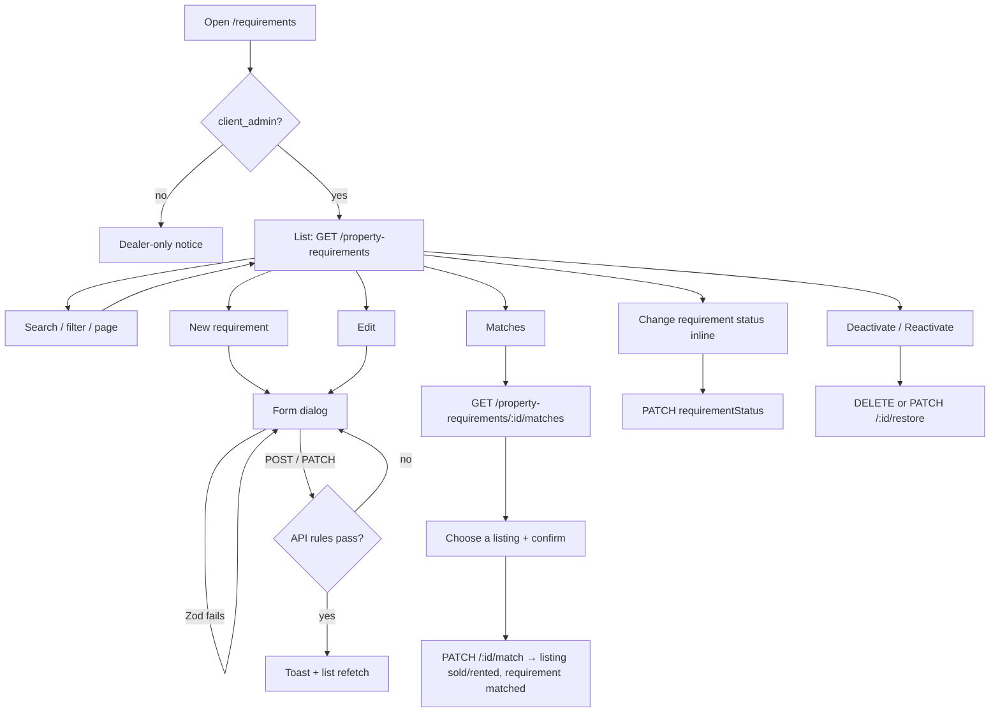

# Requirements flow

The **Requirements** screen (`/en/requirements`, `/ur/requirements`) is where a dealer records what a walk-in client wants to buy or rent. Each requirement can then be matched against the dealer's own listings.

This document follows a requirement from page load to closing, covering what the user sees, what the frontend calls, and what the backend enforces at each step.

---

## 1. Who can open it

| Check | Where | Result |
| --- | --- | --- |
| Signed in | Auth proxy ([proxy.ts](../src/proxy.ts)) | Not signed in → redirected to sign-in |
| Role is `client_admin` | [`DealerOnly`](../src/components/layout/dealer-only.tsx) → `RequireRole` (reads `GET /auth/me`) | Any other role sees the "This area is for dealers" notice instead of the page |
| Same role on the API | `@Roles(UserRole.CLIENT_ADMIN)` on the controller class | Any other role gets `403` |
| Company scope | Every query is filtered by the caller's company | A dealer only ever sees and changes their own requirements |

The sidebar only shows **Requirements** to `client_admin` ([navigation.ts](../src/config/navigation.ts)).

---

## 2. Files involved

| Layer | File |
| --- | --- |
| Route | [app/[locale]/(dashboard)/requirements/page.tsx](../src/app/[locale]/(dashboard)/requirements/page.tsx) |
| Screen | [property-requirements-view.tsx](../src/features/property-requirements/components/property-requirements-view.tsx) |
| Table | [property-requirements-table.tsx](../src/features/property-requirements/components/property-requirements-table.tsx) |
| Create / edit form | [property-requirement-form-dialog.tsx](../src/features/property-requirements/components/property-requirement-form-dialog.tsx) |
| Matches | [requirement-matches-dialog.tsx](../src/features/property-requirements/components/requirement-matches-dialog.tsx) |
| Validation | [property-requirement-schema.ts](../src/features/property-requirements/schemas/property-requirement-schema.ts) |
| API calls | [property-requirements.api.ts](../src/features/property-requirements/api/property-requirements.api.ts) |
| Query keys | [property-requirement-keys.ts](../src/features/property-requirements/api/property-requirement-keys.ts) |
| Hooks | [hooks/](../src/features/property-requirements/hooks/) — list, save, status, progress, matches |
| Types | [types/property-requirement.ts](../src/types/property-requirement.ts) |
| Text | `requirements` namespace in [messages/en.json](../messages/en.json) and [messages/ur.json](../messages/ur.json) |
| Backend | `backend/src/modules/property-requirements/` |

---

## 3. The flow at a glance



---

## 4. Step by step

### 4.1 Page load — list requirements

**User sees:** the title, a filter row (search, *Buy and rent*, *All requirement statuses*) and **New requirement** on the same line. Below that is a paginated table.

**Request:**

```http
GET /api/v1/property-requirements?page=1&limit=10&search=…&purpose=rent&requirementStatus=open
```

| Param | Source | Notes |
| --- | --- | --- |
| `page` | Pagination control | Starts at 1 |
| `limit` | `DEFAULT_PAGE_SIZE` | 10 |
| `search` | Search box, debounced 400 ms | Case-insensitive "contains" on client name, client phone, preferred city, preferred area and notes |
| `purpose` | *Buy and rent* select | `buy` or `rent`; empty sends nothing |
| `requirementStatus` | *All requirement statuses* select | `open`, `matched` or `closed` |

- The list is **newest first**, and active and deactivated requirements are shown together. The page has no active/deactivated filter.
- Any filter or search change resets to page 1, because the result set can shrink.
- `keepPreviousData` keeps the current page on screen while the next one loads.

**States:**

| State | UI |
| --- | --- |
| Loading (first time) | Skeleton |
| Error | Red alert with the API message and a **Retry** button |
| No rows | Empty state with **New requirement** |
| Rows | Table + pagination |

### 4.2 What each table row shows

| Column | Content |
| --- | --- |
| Client | Contact name and phone |
| Looking for | Purpose badge (Buy = blue, Rent = amber), property type or "Any type", and the chosen facilities, e.g. `1 bedroom · Attached bath` |
| Budget | `From X – Y`, `Up to Y`, `From X`, or "Any budget" |
| Location | `area, city`, or `—` |
| Requirement status | An inline select (`open` / `matched` / `closed`), disabled when the requirement is deactivated. Below it, *Chosen: {title}* once a listing was chosen |
| Status | Active / Deactivated badge |
| Actions | **Matches**, ✏️ Edit, ⏻ Deactivate or ↺ Reactivate |

### 4.3 Create a requirement

1. Click **New requirement**. The form dialog opens with defaults: *Wants to* = Rent, *Requirement status* = Open, *Status* = Active.
2. The dialog loads its pickers. Only **active** records are offered, newest 100 of each:
   - Clients: `GET /contacts?status=true&limit=100`
   - Property types: `GET /property-types?status=true&limit=100`
   - Facilities: `GET /facilities?status=true&limit=100`
3. Fill in the fields:

| Field | Required | Rules (frontend Zod, mirrored by the backend DTO) |
| --- | --- | --- |
| Client | ✅ | Must be chosen. Add new people under **Contacts** first |
| Wants to | ✅ | `buy` or `rent` |
| Property type | — | Empty = any type |
| Facilities | — | Searchable multi-select, shown for buy and rent. Up to 50, no repeats |
| Budget from / up to (PKR) | — | Whole rupees, 0 or more. *From* cannot be greater than *up to* |
| Preferred city | — | Up to 100 characters |
| Preferred area | — | Up to 150 characters |
| Requirement status | ✅ | `open` / `matched` / `closed` |
| Status | ✅ | Active / Deactivated |
| Notes | — | Up to 2000 characters |

4. Click **Save**. The form is checked with Zod first, and any errors appear under their fields without sending a request.
5. If valid, the form sends:

```http
POST /api/v1/property-requirements
{
  "contactId": "…",
  "propertyTypeId": null,
  "purpose": "rent",
  "budgetMin": null,
  "budgetMax": 35000,
  "preferredCity": "Lahore",
  "preferredArea": null,
  "facilityIds": ["…", "…"],
  "notes": "Needs ground floor",
  "requirementStatus": "open",
  "status": true
}
```

Empty text fields are sent as `null`, which clears that column.

6. **The backend checks, in order** (each failure returns a message that names the problem):

| Check | Failure |
| --- | --- |
| DTO validation (types, lengths, UUIDs, ≤ 50 unique facility ids) | `400` with the field message |
| Client exists in this company and is active | `400` "… is deactivated. Reactivate it first …" |
| Property type (if set) exists and is active | `400` naming the type |
| Every facility exists and is active | `400` naming the facility |
| `budgetMin ≤ budgetMax` | `400`, also enforced by the DB check `property_requirements_budget_range` |

7. **On success:** a toast says *Requirement for "Name" created.*, the dialog closes, and every `property-requirements` query is invalidated so the list refetches.
8. **On failure:** the dialog stays open and shows the API message in a red alert at the top.

### 4.4 Edit a requirement

1. Click ✏️ on a row. The same dialog opens, pre-filled from the row.
2. Facilities already on the requirement stay selectable **even if they have since been deactivated**, so they are not silently dropped. Their names come from the requirement itself.
3. **Save** sends `PATCH /api/v1/property-requirements/:id` with the full payload.
4. Backend differences from create:
   - Client, type and facilities are only re-checked when they **change**, so a record linked to something deactivated later can still be saved.
   - The budget rule compares the new value with the stored one when only one side is sent.
   - If the row disappeared mid-edit, the response is `404` "… may have been removed while you were editing it".
5. Success toast: *Requirement for "Name" updated.*

### 4.5 Change the requirement status inline

The **Requirement status** select in each row moves a requirement between:

```
open  ──►  matched  ──►  closed
  ▲__________│_____________│   (any direction is allowed)
```

- Picking a value sends `PATCH /api/v1/property-requirements/:id` with `{ "requirementStatus": "matched" }` only.
- Choosing the current value does nothing.
- Success toast: *Requirement for "Name" is now Matched.* Errors show as a red toast.
- The select is disabled on deactivated rows. Reactivate the row first.

This is the deal-progress status. It is separate from the active/deactivated **Status**.

Changing it here only changes the label. No listing is touched; to close a listing as well, use **Choose** in the matches (4.7).

### 4.6 See matching properties

Click **Matches** on any row. A dialog titled *Matches for {client}* opens and calls:

```http
GET /api/v1/property-requirements/:id/matches?page=1&limit=10&matchLevel=75
```

A **Match level** slider under the dialog title (0% on the left, 100% on the right) relaxes the rules below. Drag it or click a percentage; changing it returns to page 1. It is hidden on the confirm step.

| Match level | Checks applied |
| --- | --- |
| 100% | Everything in the table below |
| 75% (default) | Everything except facilities |
| 50% | Also ignores area |
| 25% | Also ignores budget |
| 0% | Also ignores type and city — only purpose, active and available |

**At 100%, a listing is a match when all of these hold** (empty requirement fields are ignored):

| Requirement field | Listing must… |
| --- | --- |
| Purpose `buy` / `rent` | be `sale` / `rent` |
| — | be **active** and **available** (not sold or rented) |
| Property type | have the same type (empty = any) |
| Budget from / up to | have `price` within the range |
| Preferred city / area | contain that text, case-insensitive |
| Facilities | have **every** chosen facility. Extra facilities are fine. Exact facilities only: "2 bedrooms" does not match "3 bedrooms" |

Each match shows the title, type, location, area, facilities, owner and price. Results are paginated, newest first. If nothing fits, the dialog suggests widening the budget or location, or adding a listing.

### 4.7 Choose a property for the client

1. In the matches dialog, click **Choose** on the listing the client took.
2. The dialog switches to a confirm step: *"{title}" will be marked sold/rented for {client} …*. **Back to matches** returns to the list.
3. **Mark as sold / rented** sends:

```http
PATCH /api/v1/property-requirements/:id/match
{ "propertyId": "…" }
```

4. In one transaction the backend sets the listing's `propertyStatus` to `sold` (buy) or `rented` (rent), sets the requirement to `matched` and stores `matchedPropertyId`. If either row was changed meanwhile, nothing is saved.
5. On success a toast says *"{title}" is now rented. Requirement for "{client}" is matched.*, the dialog closes, and both the requirements and properties caches refresh. The listing no longer appears in any matches, because it is no longer available.

| Check | Failure |
| --- | --- |
| Requirement is deactivated | `409` "… Reactivate it first …" |
| Requirement already has a chosen property | `409` |
| Listing purpose doesn't fit (buy ↔ sale, rent ↔ rent) | `400` naming the listing |
| Listing is deactivated, or already sold/rented | `409` naming the listing |
| Changed by another request between the check and the save | `409` "… Refresh and try again." |

**Choose** is hidden when the requirement is deactivated or already has a property. In that case the dialog shows which listing was chosen.

Choosing can't be undone from this screen. To reopen the listing, set it back to `available` under **Properties**.

### 4.8 Deactivate / reactivate

1. Click ⏻ (active row) or ↺ (deactivated row). A confirm dialog explains what happens.
2. Confirm:
   - **Deactivate** → `DELETE /api/v1/property-requirements/:id`. This is a soft delete: `status` becomes `false` and the row is kept.
   - **Reactivate** → `PATCH /api/v1/property-requirements/:id/restore`.
3. Deactivating again, or reactivating an active row, returns `409` "This requirement is already deactivated / active".
4. Toast on success, red toast on error. The list refetches.

Rows are never physically deleted.

---

## 5. API summary

All routes are under `/api/v1`, need a bearer token and the `client_admin` role, and are scoped to the caller's company.

| Method | Path | Purpose |
| --- | --- | --- |
| `GET` | `/property-requirements` | Paginated list. Filters: `search`, `purpose`, `requirementStatus`, `contactId`, `propertyTypeId`, `status`, `sortOrder` |
| `GET` | `/property-requirements/:id` | One requirement |
| `GET` | `/property-requirements/:id/matches` | Matching listings, paginated |
| `POST` | `/property-requirements` | Create |
| `PATCH` | `/property-requirements/:id` | Update (any subset of fields) |
| `PATCH` | `/property-requirements/:id/match` | Choose a listing: it becomes sold/rented, the requirement matched |
| `PATCH` | `/property-requirements/:id/restore` | Reactivate |
| `DELETE` | `/property-requirements/:id` | Deactivate (returns `200` with the row) |

Response shape of one requirement:

```json
{
  "id": "…",
  "contactId": "…",
  "contactName": "Hina Tariq",
  "contactPhone": "03121234506",
  "propertyTypeId": "…",
  "propertyTypeName": "Portion",
  "purpose": "rent",
  "budgetMin": null,
  "budgetMax": 35000,
  "preferredCity": "Lahore",
  "preferredArea": null,
  "facilities": [{ "id": "…", "name": "1 bedroom" }, { "id": "…", "name": "Attached bath" }],
  "notes": "…",
  "requirementStatus": "matched",
  "matchedPropertyId": "…",
  "matchedPropertyTitle": "Furnished studio room, Gulberg",
  "status": true,
  "createdAt": "2026-08-08T10:00:00.000Z",
  "updatedAt": "2026-08-30T10:00:00.000Z"
}
```

`facilities` is sorted by name. The API takes `facilityIds` and returns `facilities`.

---

## 6. Data and caching

- **Table:** `property_requirements`, linked to `contacts`, `property_types` (nullable), `properties` through `matched_property_id` (nullable) and `companies`. `facilities` is a `uuid[]` column of facility ids.
- **Query keys:** `["property-requirements", "list", params]` and `["property-requirements", "matches", id, params]`.
- Create, update, progress, deactivate and restore all invalidate `["property-requirements"]`, which refreshes both the list and any open matches. Choosing a listing also invalidates `["properties"]`.
- Renaming a property type or facility also invalidates requirements, because rows show those names.

---

## 7. Try it with demo data

With `pnpm db:seed:demo` loaded, sign in as the demo dealer (`SEED_DEMO_ADMIN_EMAIL` / `SEED_SUPER_ADMIN_PASSWORD`) and open **Requirements**:

| Try | Expect |
| --- | --- |
| **Matches** on Zainab Raza (Room, ≤ 20,000, 1 bedroom + Attached bath) | Several Lahore rooms |
| **Matches** on Rabia Khalid (Flat, Karachi, 2 bedrooms + Attached bath + Parking) | The Clifton 2-bed flat |
| **Matches** on Sana Javed (Plot ≤ 8,000,000) | No matches |
| Filter *Rent* + *Open* | Only open rent requirements |
| Search `0312` | Hina Tariq's requirements, found by phone |
| Edit any rent requirement → add a facility no listing has → **Matches** | The match count drops |
| Deactivate a requirement | Its status select becomes disabled; ↺ brings it back |

---

## 8. Error messages you may see

| Message | Cause | Fix |
| --- | --- | --- |
| *Choose the client.* | No client picked | Pick one, or add them under **Contacts** |
| *The upper budget cannot be lower than the lower budget.* | From > up to | Swap or clear one |
| *… is deactivated. Reactivate it first …* | Linking a deactivated client, type or facility | Reactivate it, or pick another |
| *No facility was found with id …* | Facility removed or from another company | Pick from the list again |
| *This requirement is already deactivated / active* | Double click, or a stale page | Refresh |
| *… may have been removed while you were editing it* | Row changed in another tab | Close and reopen |
